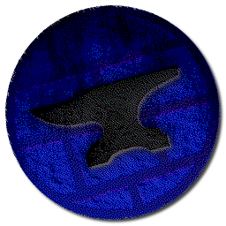
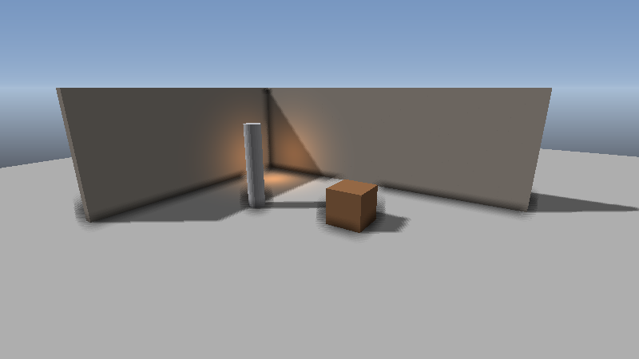

<p align="center">
  
</p>

<h1 align="center">Anvil</h1>

<p align="center">
  A Hammer-style level editor written entirely in Rust, for <b>Roblox</b>, <b>Unity</b> and <b>Blender</b>.
  <br>
  <a href="https://github.com/STALKERLOVESONG/Anvil/releases/latest">Download</a> ·
  <a href="#features">Features</a> ·
  <a href="#building-from-source">Build from source</a> ·
  <a href="CHANGELOG.md">Changelog</a>
</p>

<p align="center">
  <a href="https://github.com/STALKERLOVESONG/Anvil/actions/workflows/ci.yml"></a>
</p>

<p align="center">
  
</p>

Block out maps with brushes, whole buildings, stairs, editable meshes, props and decals in
four viewports. Playtest them at Roblox scale, edit together with friends, extend the
editor with plugins, and export to Roblox (files, or uploaded through Open Cloud), Unity or
Blender.

## Features

- **Building:**
  - Brushes and presets, walls, and whole buildings from an outline (with floor, ceiling
    and trim).
  - Doors and windows as real boolean holes, on walls and meshes.
  - Stairs with railings, a knife, mesh union / subtract / intersect, 3D text from any
    installed font.
- **Editing:**
  - Move / rotate / scale gizmo with plane handles and Local / Global axes.
  - Vertex and face editing, and a UV editor.
  - Per-face textures with tint, collisions that stop parts flush, Shift-constrain, and a
    randomize scatter.
- **Looks:** a software renderer with sun shadows, point lights, ambient occlusion, sky,
  fog and mipmapped textures. Five UI themes.
- **Content:**
  - OBJ / STL / glTF models with thumbnails.
  - Half-Life / Source content (VPK, GMA, MDL, VTF), and a Sketchfab browser plugin.
- **Roblox:**
  - `.rbxmx` and command-bar Luau export, and Open Cloud upload.
  - MaterialVariants with normal / roughness / metalness maps.
  - ProximityPrompts and working teleports, plus live sync into Studio.
- **Unity and Blender:**
  - Unity: `.obj` + `.mtl` export, plus an entity script.
  - Blender: a textured `.glb` or a real `.blend` (folders become collections), plus live
    sync into Blender.
- **Together:**
  - Team Create over your LAN or a VPN, with live edits, floating cameras and colored
    selections.
  - Invite codes, host approval, and no IP sharing between guests.
- **Safe by default:**
  - Plugins have to be approved, and their web and file access is fenced in.
  - Your Roblox key is encrypted for your Windows account.
  - Packages have size caps against zip bombs.
  - Updates are checked against their published SHA-256.

## Getting it

Grab `Anvil-x.y.z.zip` from the [latest release](https://github.com/STALKERLOVESONG/Anvil/releases/latest),
unzip it anywhere and run `anvil.exe` (Windows 10/11). Anvil tells you when a new version is
out and can update itself.

## Building from source

You need [Rust](https://rustup.rs) (stable) on Windows.

```
cargo run --release
```

**`build.bat`** makes a small, optimized `anvil.exe` (no console, no debug info). It puts it
with the plugins and README in a `dist\Anvil` folder next to the build output, plus a zip
and its SHA-256, ready to share. Tagged pushes (`v1.2.3`) build the same thing on GitHub
Actions and publish it as a release.

You can also pass a map: `anvil.exe mymap.anvil`.

The exe, window and taskbar use the anvil badge (`assets/anvil_logo.png` /
`assets/anvil.ico`). The "ANVIL" title in the menu bar is OCR A Extended italic, which is
loaded from Windows' fonts at startup and isn't shipped, because it's a licensed font. On
PCs without it, the title uses the normal font. Click the logo for About.

## Tools (keys 1-0)

| Key | Tool | What it does |
|---|---|---|
| 1 | Select | Click to select. Shift or Ctrl+click adds. Drag to move, drag the handles to resize (Shift = even on all axes), Shift+drag clones. |
| 2 | Block | Drag a rectangle to draw a brush (Shift = perfect square), or click to drop the active preset |
| 3 | Wall | Drag a line in the Top or 3D view |
| 4 | **Building** | Shift+drag two corners for an exact rectangle (add Alt for a square), or click the corners of a closed loop. Click the first point, double-click or press Enter to close it. This builds walls (corners overlap cleanly) plus an optional floor and ceiling, all in a new folder. |
| 5 | **Polygon** | Same loop. Once it's closed, move the mouse to set the height live (snaps; Ctrl = free), then click to build one extruded mesh you can edit. Esc cancels. |
| 6 | **Door** | Click a wall to cut a door-shaped boolean hole (works on meshes and odd-shaped brushes too: the opening lines up with the face you click). On a floor it cuts a hatch. Hovering shows where it'll go; hold the mouse down to see it clearly and slide it, then let go to cut. Ctrl = no snapping. |
| 7 | **Window** | Same as Door, for a window hole with an optional glass pane (the preview shows both) |
| 8 | Prop | Place a library model (.obj / .stl / .glb / .gltf). A see-through ghost shows where it'll land, in every view. Presets, lights and spawns get a ghost too. |
| 9 | **Decal** | Click a wall or floor to stick a textured plane on it (dirt, posters, papers) |
| 0 | Light | Point light |
| - | Spawn | Flat spawn pad (playtest starts here). Visible in the editor, invisible in the exported game. |
| - | **Stairs** | Click the bottom, then the top (a floor above, the top of a wall). Builds steps, side trim and handrails in a Stairs folder. Width, step height and rails are set in the tool panel. Steps and posts can be swapped for your own prefab: select it, then click *Use selection*. |
| - | **Prompt** | A Roblox ProximityPrompt ("Press E to …"). The Inspector edits its action/object text, key, gamepad button, hold time, range, line of sight, style and UI offset. |
| - | **Teleport** | Click the pad, then where it sends players. Touch pads or prompt teleports, with cooldown and exit offset; *Two-way* makes a pad back. Exports to Roblox with a working Script. |
| - | **Knife** | Drag a line across walls or meshes. **Split** cuts them into two objects, **Slice** just adds an edge. Cuts the selection, or everything under the line. |
| - | Plugin tools | Any tool plugin, e.g. **Align Sizes** |

**Boolean carve** (Ctrl+Shift+C): every selected box cuts a hole in the box brushes it
overlaps, and then the cutters are removed. Openings are kept as editable holes on the
brush, listed in the Inspector, where you can tweak or remove them.

## Move / rotate / scale

- **Toolbar:** the top bar has **Move (W)**, **Rotate (E)**, **Scale (R)** and **Global/Local (X)**. Local uses the object's own axes for moving, rotating and scaling.
- **Objects:** the handles come from the Transform Gizmo plugin.
- **Mesh edit mode:** the same handles appear on the selected vertices or faces.
- **Snapping:** handles snap to the grid, and rotation snaps to 15°. Hold **Ctrl** to drag freely.

## Collisions and plane handles

- **Collisions** (the ⛶ button in the top bar, or the Select tool's settings): works like
  Roblox Studio's Collisions toggle.
  - **Moving:** dragging, the gizmo and arrow keys stop a part flush against whatever it
    would push into. It still slides along walls and floors, and it won't jump through
    thin walls.
  - **Rotating:** the gizmo ring and *Rotate 90°* stop at the angle where the part
    touches something.
  - **What counts:** real shapes are tested, not boxes. Parts with *Collide* off are
    ignored.
  - **Off** (the default) moves freely, like before.
- **Plane handles:** in Move mode the gizmo has three small colored squares between the
  arrows. Drag one to move only in that plane (for example along the floor without
  changing height).
  - Works in Local and Global mode and snaps to the grid (Ctrl = free).
  - Also on the vertex/face gizmo in mesh edit mode.

## 3D view buttons

The 3D view's header has **Persp / Top / Bottom / Front / Back / Left / Right**. All but Persp are flat (orthographic) views inside the 3D view:

- Right- or middle-drag to pan.
- Scroll to zoom toward the cursor.
- **Persp** returns to where your camera was.

## Textures per face, tint and settings

- **Inspector → Texture settings:**
  - tile size ×, offset, rotation, and **tint** (a color multiplied into the texture, like Roblox Texture.Color3)
  - Roblox textures can't rotate, so rotation shows in the preview and Unity only.
- **Faces tool:**
  - Click faces of walls, floors or meshes (Shift/Ctrl+click adds), then give just those faces their own texture and settings.
  - Mesh edit face mode (Tab, then 2) has the same panel.
- **Exports:**
  - Roblox gets one `Texture` per face, with `Color3` set to the tint.
  - Unity gets one material per texture.

## Tool settings, trim and themes

- **Tool settings:** the box under the tool list shows the active tool's options.
  - **Wall / Building:** height, thickness, colors and materials, floor and ceiling,
    **trim**, and textures for new walls and floors.
  - **Door / Window:** sizes, sill and glass.
  - **Other tools:** light range and brightness, spawn and decal size, polygon height,
    knife mode, text, and stairs.
- **Building trim:** tick *Baseboard* and/or *Crown* and the Building tool adds strips
  along the inside of the walls, with clean corners. Doors and windows cut through any
  trim they overlap.
- **Themes:** View → Theme (or Settings > Look) offers Dark, Light, Hammer grey, Midnight
  blue and High contrast, plus an accent color.

## Mesh booleans

Edit → Boolean (the first object you selected is the one that changes):

- **Union** merges the other selected shapes into it.
- **Subtract** cuts them out of it.
- **Intersect** keeps only the overlap.

Works on any brush shape, editable meshes and props. A typical use: drop a cube or a
sphere where you want it, select the model and then the shape, and pick Subtract. The
result is an editable mesh (Tab).

## Sketchfab (plugin)

Plugins → **Sketchfab** → *Open window*.

1. Search for downloadable models. Results show pictures, authors and licenses.
2. **Download** puts one straight into the model library (glTF with textures).
3. Downloading needs your own Sketchfab API token (sketchfab.com → Settings → Password &
   API). It's saved encrypted for your Windows account.
4. Check each model's license on its page before you use it.

Plugins of the new **panel** kind can have their own windows, and can reach the websites
they list (HTTPS only, shown before you allow the plugin). They can only download, unzip
and import inside their own folder.

## PBR maps

Textures can also have a **roughness** and a **metalness** map (Textures window).

- Open Cloud uploads them with the rest.
- Roblox exports put them on the texture's MaterialVariant (`RoughnessMap` /
  `MetalnessMap`).

## Blender export

Export → Unity / Blender tab → **Blender file (.blend)…** or **Scene (.glb)…**

- **The scene:** one Blender object per Anvil object, with textures embedded, colors,
  transparency and point lights. Units follow *Meters per unit*.
- **The .blend:** if Blender is installed (found automatically, including the Steam
  version, or set `blender.exe` yourself), Anvil runs it in the background to save a real
  `.blend` where your folders become collections.
- **Without Blender:** the `.glb` opens with File → Import → glTF 2.0.

## Updates and security

- **Updates:**
  - Anvil checks this repository's latest release when it starts (turn that off in
    **About**, click the logo).
  - Anvil checks the latest release when it starts (you can turn that off).
  - If there's a newer one, a banner offers **Update**:
    - It downloads only from GitHub over HTTPS.
    - It refuses releases without a published SHA-256, and checks the download against it.
    - It keeps the old version as `anvil.old.exe`.
- **Roblox API key:** saved encrypted with Windows (DPAPI), so only your Windows account
  can read it. An older plain-text key is converted automatically.
- **Plugins:**
  - A new or changed plugin script doesn't run until you click **Allow** (you see its
    code first).
  - The bundled plugins are always allowed.
  - Plugins can't run programs. They can only reach the websites they list (HTTPS), and
    only read and write files inside their own folder.
- **Packages:**
  - Opening an `.anvilpak` can't write outside its folder.
  - It's capped at 20,000 files, 512 MB per file and 3 GB in total, which stops "zip
    bombs".

## Live sync to Roblox Studio and Blender (experimental)

Settings → *Experimental: live sync*. Tick **Live sync on**, then:

- **Roblox Studio:** click *Install Roblox Studio plugin* and restart Studio.
  1. Click **Plugins → Live sync**. Studio asks once whether the plugin may talk to
     127.0.0.1; allow it.
  2. The map appears in `workspace.AnvilLive` and follows your edits.
- **Blender:** click *Save Blender add-on…*.
  1. In Blender: Edit → Preferences → Add-ons → Install…, pick the file, and tick it.
  2. In the 3D view sidebar (N), open **Anvil → Start live sync**.
  3. The map appears in an "Anvil Live" collection.
- **Updates:** only changed objects are sent, a few times a second. It's one-way (Anvil →
  Studio / Blender).

**Safety:**
- The server listens on 127.0.0.1 only and is read-only.
- Every request needs the secret token built into the plugin and add-on. *New token*
  makes old copies stop working.
- It refuses requests whose Host isn't localhost, so a web page can't reach it through
  DNS tricks.
- It never adds CORS headers, so websites can't read the data.

## 3D lighting (View → 3D lighting)

The 3D view is lit like a real scene. Pick a quality to match your PC:

| Quality | What you get |
|---|---|
| Off | The old flat shading (fastest) |
| Low | Sky light, a sky gradient, distance fog, and **Light objects actually light things** (in their color, fading with range) |
| Medium (default) | + **sun shadows** |
| High | + soft shadow edges and **ambient occlusion** (darker creases where walls meet floors) |
| Ultra | + sharper shadows that reach further, and stronger AO |

- **Settings:** set the sun's direction (compass angle and height), the sky and the fog
  distance in Settings > Viewports.
- **Speed:** shadows are only redrawn when something moves.
- **What it affects:** only the preview. Exports are unchanged.

## Hiding, right-click menu, drag-and-drop textures, randomize

- **Hiding:**
  - **H** hides the selection, **Shift+H** hides everything else (isolate), and **U**
    shows everything again.
  - The Inspector has **Hide / Isolate / Unhide all** buttons, and every row in the
    Objects list has an eye icon.
- **Right-click** an object in any view for Hide, Hide everything else, Unhide all,
  Focus, Duplicate, Apply active texture and Delete.
- **Drag a texture** (its picture in the Library list or the Textures window) onto an
  object in any view to apply it. Hold **Alt** while dropping to put it on just that one
  face.
- **Edit → Randomize offset / rotation…:** small random nudges, only on the axes you tick
  (for example X/Z offset plus Y rotation), so clutter looks placed by hand.
  - **Re-roll** tries again from where things were before, in the same undo step.
  - Set a seed for the same result each time.

## UV editor (Ctrl+U)

Edit → UV editor, or *Open UV editor* under a texture's settings.

- **What it edits:** the selected objects, or the selected faces when you're using the
  Faces tool.
- **The canvas** shows the texture tiling behind the face's real UV outline:
  - **Drag inside** to slide the texture.
  - **Drag a corner** to scale it (Shift keeps it even).
  - **Drag the ring** to turn it.
  - **Scroll** to zoom.
  - **Snapping:** moves snap to 1/8 tile, scale to 1/8 steps, rotation to 15°. Hold
    **Ctrl** to drag freely.
- **Buttons:**
  - **Fit to face** stretches the texture exactly once across the face. For a whole
    object it uses the biggest face.
  - **Rotate 90°**, **Reset**, plus the number fields.
- **In the 3D view** (while the UV editor is open): **Alt+drag** a face to slide its
  texture with the mouse, and **Alt+Shift+drag** to turn it.

## Thumbnails

- **Model library:** shows a rendered picture of every model (textured). Click a picture
  to pick that prop.
- **Textures list:** shows small swatches.
- **Half-Life browser:** shows a preview of the selected prop straight from the game
  files, without importing it.
- **Caching:** pictures are kept in a `thumbs` folder next to anvil.exe and redrawn when
  the model file changes.

## 3D text

- **Placing:** pick the **Text** tool, type, search your installed fonts, set height and depth. Click a wall to lay it flat on the wall, or the floor to stand it up facing you.
- **Sharing:** it's saved as a mesh, so people without the font still see it.
- **Editing:** the Inspector edits and rebuilds it.

## Team Create (Team menu)

Edit one map together, live, like Roblox Team Create.

- **Host:** Team → Team Create… → *Start hosting*. Give friends your address and the
  invite code. When someone asks to join, you click **Allow** or **Deny**.
- **Join:** type the host's address and invite code, then click *Join*. Your open map is
  replaced with the host's map, so save it first if you want to keep it.
- **While you work:**
  - Everyone's edits sync about 10 times a second.
  - Other people float in the views as colored balls with their name and tool.
  - Whatever they have selected is outlined in their color.
  - Undo only undoes your own changes.
- **Textures and models:** the files the map uses are copied over automatically.

**Safety**
- **Your IP address:**
  - Guests only ever connect to the host, so guests never see each other's IP addresses.
  - The host only accepts people on the same network or VPN (Tailscale / ZeroTier `100.x`
    addresses work) unless you tick *Allow joins from the internet*.
  - With internet joins on, people who connect can see your IP address. Using a VPN mesh
    is safer and keeps real IPs private.
- **Who can get in:** every join needs the invite code *and* your approval. Wrong codes
  are slowed down and blocked after 5 tries. Both sides must run the same Anvil version.
- **What peers can send:** only plain data, never code.
  - Everything received is checked first: sizes, numbers and mesh indices. Anyone who
    sends broken data is removed.
  - Messages and connections have size and rate limits.
- **Files:**
  - Only files the map uses *and* that were added on your own PC are ever sent. A peer
    can't ask for anything else, even by adding a path to the map.
  - Downloaded files go into a `team_files` sandbox folder with cleaned-up names.
- **Network paths:** Anvil never opens `\\server\share` paths from a map, so a map
  can't make Windows hand your login hash to someone else's server.

## Mesh editing (Tab)

Select a mesh and press Tab. A brush is converted to an editable mesh first.

- **1**: vertex mode. **2**: face mode.
- Click or marquee to select, drag to move (snaps to the grid). Use the Front and Side views to move things vertically.
- **Ctrl+E** extrudes the selected faces, **M** merges vertices, **N** flips faces, **Del** deletes. You can type a single vertex's exact position in the panel.

## Folders

Shift+click several objects, then press **Ctrl+G** (or click Group) to put them in a folder.
Folders nest, and can be renamed, hidden, selected or ungrouped from the Objects list. They
export as Models in Roblox and as name prefixes in Unity.

## Playtest (F5)

A first-person character at Roblox scale: 2×5 studs, 16 studs/s walk, 50 studs/s jump and
Roblox gravity. It collides with every part that has CanCollide on. Controls: WASD, mouse look,
Space to jump, Shift to run, Esc to stop. You start on the first Spawn, or under the camera if
there isn't one.

## Textures & decals

**Textures** window → *Add texture…* and pick an image. Each texture has:

- a normal map (optional)
- a **Metallic** flag and a base material
- **scale** (units per tile) and **offset** (units)
- Roblox image and normal ids, filled in automatically by an upload

Use *Apply to selection* to texture parts, or *Use for decals* to pick the decal image. The 3D
view previews textures, normal maps, metal sheen and decal transparency.

## Plugins

Plugins are [Rhai](https://rhai.rs) scripts in the `plugins` folder next to `anvil.exe`.
Use **Plugins → New plugin…** to start from a template that lists the whole API. There are
three kinds:

- `command`: runs once from the Plugins window
- `tool`: receives viewport clicks, with the hit object, point, normal and nearest edge
- `move`: adjusts the drag while the selection is being moved
- `gizmo`: draws handles on the selection in every viewport and owns drags that start on them (`draw`, `pointer_down`, `pointer_drag`, `pointer_up`, `on_key`)

Bundled plugins:

- **Transform Gizmo** (gizmo, on by default): Unity-style handles on the selection with the Select tool.
  - **W** move: drag an arrow to slide along that axis, or the center square to move freely.
  - **E** rotate: drag a ring. It snaps to 15°.
  - **R** scale: drag a cube to stretch along that axis, or the center cube to scale everything.
  - **X** switches between global and local axes.
  - Hold **Ctrl** to turn snapping off. It works in all four views and with several objects selected (it pivots on the selection's center).
  - Because it's a script (`plugins/transform_gizmo.rhai`), you can change handle size, colors or snapping and press Reload; no recompiling.

- **Align Sizes** (tool): click an edge on the part to stretch, then an edge on the target. The first part grows or shrinks along its own axis until the edges line up, and its opposite side stays put.
- **Snap To Part** (move, on by default): while you drag, the selection snaps flush against nearby parts and is pushed back out instead of overlapping them.
- **Random Colors** (command): a small example.

Each plugin run is one undo step. Scripts are limited to 5M operations, so a runaway loop can't hang the editor.

## Saving & sharing

- **Save** (Ctrl+S) writes an `.anvil` map. It's JSON, and it points at your texture and model files where they are on your PC.
- **File → Save package for sharing (.anvilpak)** writes one file holding the map plus every texture, normal map and prop it uses, including each prop's `.mtl` and its textures. Uploaded Roblox ids come along too.
  - Send that file to anyone. **File → Open** on an `.anvilpak` unpacks it into `packages/<name>/` next to `anvil.exe` and loads the map with all paths fixed.
- **File → Open recent** lists your last 10 maps.
- **Autosave**: every 3 minutes while there are unsaved changes, the map is saved to `autosave/` next to the exe. Change the interval in `anvil_settings.json` with `autosave_minutes`; 0 turns it off.

## Half-Life / Source content

**Content** (menu bar), or **File → Half-Life / Source content…**, mounts content from Source games. The first time, it auto-detects Garry's Mod, Half-Life 2, CS:S, TF2, Portal and other Source games in your Steam libraries. You can also add:

- a game folder
- a `*_dir.vpk` archive
- a GMod `.gma` addon
- any folder with `models/` and `materials/` (loose GMod addons work, even oddly laid out ones)

Then:

- **Props**: search, then double-click (or *Import & place*). The MDL/VVD/VTX model and its VMT/VTF textures are converted into a normal OBJ + PNGs under `content/`. It's added to the model library, and the Prop tool is selected. It shows textured in the 3D view, exports to Unity with its textures, and uploads to Roblox as a textured `.glb`.
- **Materials**: preview, then *Import as texture*, *Import + apply to selection* or *Import + use as decal*. Normal maps (`$bumpmap`) come along.
- **Import scale**: default 0.07, so a 72-unit HL2 character is about 5 studs. Set it in the Content window.

Supported: VPK v1/v2, GMA v1-3, VTF 7.0-7.5 (DXT1/3/5 and the common uncompressed formats), and MDL v44-49 (Half-Life 2 / GMod / Source SDK 2013).

## Export

**Export** window (also in the menu bar):

- **Unity**: an `.obj` + `.mtl` with UVs, copied texture images, normal maps (`map_Bump`) and metal (`Pm`). Lights and spawns go into a `*_AnvilEntities.cs` editor script.
- **Roblox files**: `.rbxmx`, or a Command Bar `.lua` script (or copy it to the clipboard). These map shapes as follows:
  - Box, wedge, cylinder and sphere brushes become native parts.
  - Holed walls become a Model of pieces.
  - Editable meshes become WedgePart triangle pairs.
  - Decals become Decal instances.
  - Plain textures become Texture faces (with offset). Textures with a normal map or Metallic become a MaterialVariant.
- **Roblox Open Cloud upload**: paste an API key that has the **Assets** API with **Read + Write** permission, and set your user or group id. Then upload:
  - textures and normal maps as Decal assets (their ids are written back into the map)
  - the props a map uses, as `.glb` Model assets (inserted by the Command Bar script with InsertService)
  - the whole map as a Model asset; *Copy insert snippet* gives you a one-line Command Bar insert

  The key is kept only in memory unless you tick *Remember*. If you do, it's saved to `anvil_secrets.json` next to the exe, never inside maps or settings. You can also set the `ANVIL_ROBLOX_API_KEY` environment variable instead.

## Tests

```
cargo test --release
```

The tests cover:

- primitive winding and map save/load
- door, window and carve geometry
- the wedge-triangle decomposition
- concave triangulation, extrude and weld
- both bundled plugins
- player physics
- GLB output and the Open Cloud request body
- both exporters
- a textured render snapshot

Set `ANVIL_TEST_OUT=<dir>` to keep the outputs.
